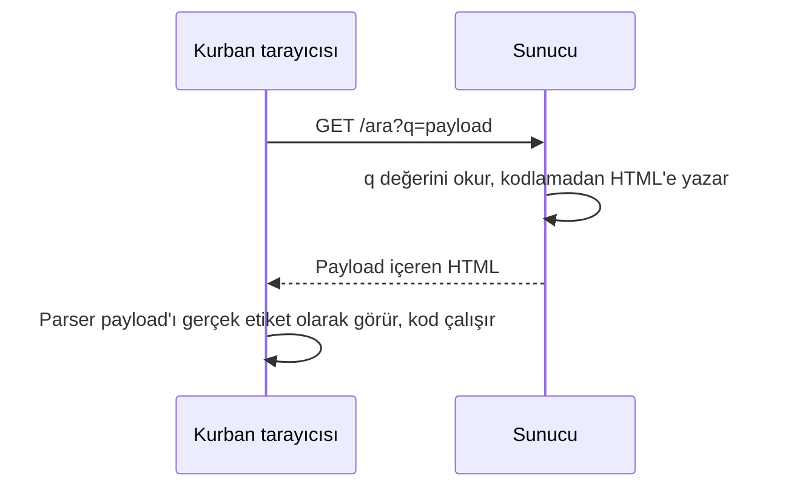
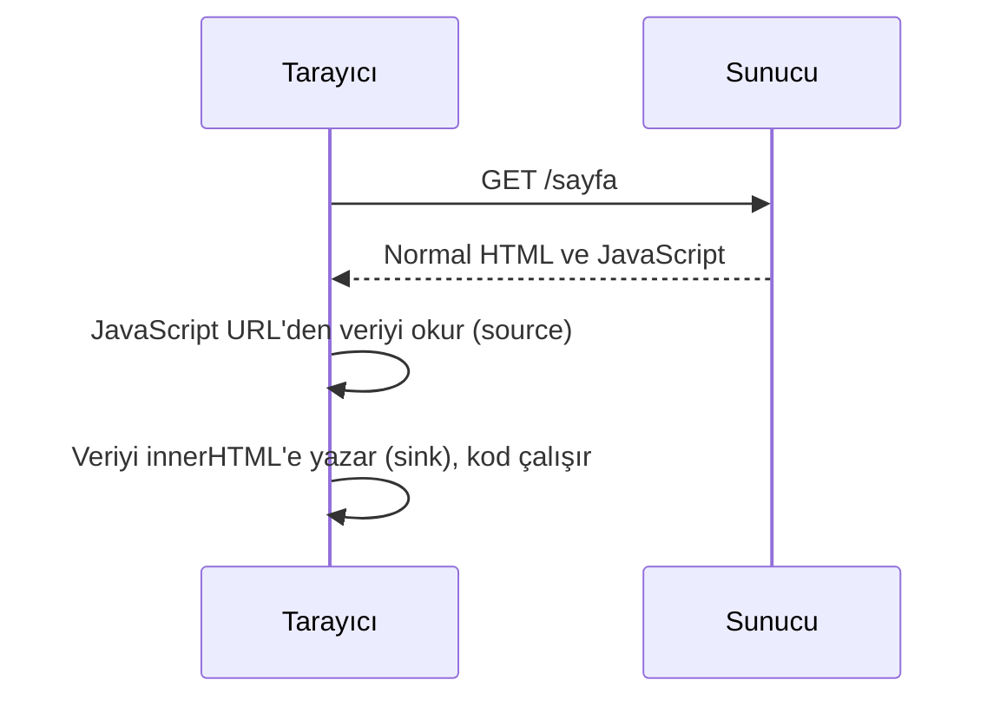

# XSS'i Gerçekten Anlamak: Tarayıcıdan Payload'a Kadar

> **Not:** Bu yazı eğitim amaçlıdır. Anlatılan teknikleri yalnızca kendi kurduğun laboratuvar ortamlarında ya da test izni olan sistemlerde dene.

Bir XSS payload'ına ilk baktığında şuna benzer bir şey görürsün:

```html
">
```

Bunu ezberlemek kolay, anlamak zor. Bu yazıda o satırın neden çalıştığını sıfırdan kuruyoruz: tarayıcı bir sayfayı nasıl oluşturur, kim kime güveniyor ve bu güven tam olarak nerede kırılıyor.

## XSS tek cümlede

Cross-Site Scripting (XSS), saldırganın yazdığı kodun, hedef sitenin kendi kodu gibi çalışmasıdır. Bunun için bir sitenin iki hatayı birlikte yapması yeterli:

1. Saldırganın hazırlamış olabileceği bir girdiyi kabul etmek.
2. O girdiyi, kod olarak çalışamayacağından emin olmadan sayfaya koymak.

Gerisi, tarayıcının nasıl çalıştığından geliyor. Önce oradan başlayalım.

---

## 1. Zemin: Tarayıcı sayfayı nasıl kurar?

### Sunucu cevap verir, tarayıcı yorumlar

Bir siteye girdiğinde tarayıcı sunucuya bir HTTP isteği yollar, sunucu da bir HTML dokümanı döner. Bu doküman ağda sadece bir bayt dizisidir. `<h1>` ya da `<div onclick="...">` bu aşamada sıradan karakterlerden ibarettir.

HTTP ayrıca **durumsuzdur** (stateless): sunucu bir önceki isteği hatırlamaz. Seni oturumlar boyunca tanıyabilmesi için bir **cookie** verir:

```
Sunucu   →  Set-Cookie: session=x9k2m7
Tarayıcı →  her istekte otomatik ekler: Cookie: session=x9k2m7
```

Cookie, bir kimlik kartı gibi çalışır. Çalınırsa hesap da çalınmış sayılır. Bu yüzden XSS'in en bilinen hedefi cookie'dir.

### HTML'den DOM'a

Gelen metni önce **HTML parser** okur. Soldan sağa tarar, etiketleri parçalara ayırır ve bunlardan bellekte bir ağaç kurar. Bu ağaca **DOM** (Document Object Model) denir.

DOM pasif bir görüntü değil. Her düğüm, özellikleri ve metotları olan gerçek bir JavaScript nesnesi. JavaScript sayfayı bu yüzden hem okuyabiliyor hem değiştirebiliyor. Tarayıcı ekrana çizdiği her şeyi bu ağaçtan üretir. HTML dosyası, ağaç kurulduktan sonra bir kenara çekilir.

Birkaç önemli ayrıntı:

- **Parser toleranslıdır.** Eksik ya da bozuk etiketleri "en iyi tahminle" düzeltir. Bu yüzden kapatılmamış bir `` görünce durur.** Script çalışır, bitince parser kaldığı yerden devam eder. Tarayıcı, o script'i kimin yazdığını ayırt edemez.
- **Her şey tarayıcıda olur.** JavaScript'in DOM'da yaptığı değişiklik sadece o sekmenin hafızasındaki kopyayı etkiler. Sunucudaki HTML aynı kalır, sayfayı yenilersen değişiklik kaybolur.

Bunu kendin görmek istersen iki farklı araç var:

| Araç | Ne gösterir |
|---|---|
| View Page Source (Ctrl+U) | Sunucudan gelen **orijinal** HTML |
| Inspect Element (F12) | JavaScript'in değiştirdiği **güncel** DOM |

Bir XSS'in payload'ı sunucunun HTML'inde mi geliyor, yoksa tarayıcıda mı ekleniyor sorusunun cevabını çoğu zaman bu iki araç arasındaki farkta bulursun.

### `window` ve `document`

`window`, tarayıcı sekmesinin en dış kabuğu ve JavaScript'in global nesnesidir. URL (`location`), zamanlayıcılar, `fetch`, geçmiş (`history`) hepsi orada. `document` ise bu kabın içindeki tek bir özelliktir (`window.document`) ve sayfanın DOM ağacının köküdür.

Pratikte:

- `document.*` sayfa içeriğiyle ilgilidir (`document.body`, `document.cookie`, `getElementById`).
- `window.*` pencereyle ilgilidir (`location`, `alert`, `setTimeout`).

DOM'a dokunan her kod `document`'tan geçer. Payload'larda hep `document.` görmenin sebebi bu.

---

## 2. Kim kime güveniyor? Origin, SOP ve CORS

### Origin

Bir kaynağın kimliği üç parçadan oluşur: **protokol + alan adı + port**. İkisi aynı origin sayılsın diye üçünün de birebir eşleşmesi gerekir:

| URL (referans: `https://site.com`) | Aynı origin mi? | Neden |
|---|---|---|
| `https://site.com/profil` | Evet | Yol farkı önemli değil |
| `http://site.com` | Hayır | Protokol farklı |
| `https://blog.site.com` | Hayır | Alan adı farklı |
| `https://site.com:8443` | Hayır | Port farklı |

### Same-Origin Policy (SOP)

SOP, tarayıcının temel güvenlik kuralı: bir origin'in JavaScript'i, başka bir origin'in verisini **okuyamaz**.

Burada akılda tutulması gereken ayrım şu: **SOP göndermeyi engellemez, okumayı engeller.** Başka bir siteye istek gidebilir, o istek sunucuda işlenebilir. Tarayıcı yalnızca cevabı JavaScript'ten saklar.

Bir bankaya giriş yaptığını ve başka sekmede kötü niyetli bir site açtığını düşün. O sitenin kodu bankaya istek atarsa tarayıcı cookie'ni isteğe kendiliğinden ekler. SOP sayesinde cevap, yani bakiyen ve hesap bilgilerin, o siteye verilmez.

**XSS ile bağlantısı:** SOP kodun kim tarafından yazıldığına değil, **hangi origin'den çalıştığına** bakar. XSS'te saldırganın kodu hedef sitenin kendi sayfasının içinde çalışır, yani origin aynıdır. Bu yüzden XSS, SOP'u kırmaz, **kandırır**.

### CORS: duvardaki kapı

Bazen farklı origin'ler arasında meşru veri alışverişi gerekir (örneğin ön yüz `frontend.com`'da, API `api.backend.com`'da). CORS bu durumda sunucunun açtığı kapıdır: sunucu `Access-Control-Allow-Origin` gibi header'larla kimin okuyabileceğini söyler, **tarayıcı bunu uygular**.

Birkaç ilke:

- CORS bir tarayıcı kuralıdır. `curl` ya da Postman gibi araçlarda tarayıcı olmadığı için CORS kontrolü de yoktur. Yani sunucuyu korumaz.
- `POST`, `PUT`, `DELETE` gibi yan etkisi olan isteklerden önce tarayıcı bir **preflight** (`OPTIONS`) isteği atar. Sunucu izin vermezse asıl istek hiç gönderilmez.
- Sık yapılan hatalardan biri, gelen `Origin` header'ını olduğu gibi `Access-Control-Allow-Origin`'e yazmaktır. Bu, saldırganın sitesi dahil herkese izin vermek demektir.

Zayıf CORS yapılandırması ile XSS bir arada olursa, enjekte edilen kod başka bir API'den veri çekip okuyabilir. Tek başlarına orta riskli olan iki hata birleşince risk ciddi seviyeye çıkar.

### Cookie bayrakları ve HttpOnly

| Bayrak | Ne yapar |
|---|---|
| `HttpOnly` | JavaScript'in cookie'yi **okumasını** engeller |
| `Secure` | Cookie yalnızca HTTPS üzerinden gönderilir |
| `SameSite` | Cookie'nin başka sitelerden gelen isteklere eklenmesini sınırlar |

`HttpOnly` önemli bir korumadır ama sihirli değil. Tarayıcı cookie'yi saklamaya ve her isteğe kendiliğinden eklemeye devam eder. Yani saldırgan cookie'yi **okuyamaz**, ama sayfanın içinde çalışan kodla kurban adına istek **gönderebilir**. `HttpOnly` çalmayı önler, kötüye kullanmayı önlemez.

---

## 3. XSS'in kavram seti: source, sink, vector, context

Bu dört kelimeyi ayırabilirsen payload'lar çok daha kolay okunur. Bir silah benzetmesiyle:

- **Source:** Saldırganın kontrol edebildiği verinin kodda okunduğu nokta. Şarjör gibidir, tek başına zararsız. (`location.search`, `location.hash`, `document.referrer`, `localStorage`, form alanları)
- **Sink:** Veriyi HTML'e ya da koda çeviren nokta. Tetik gibidir. (`innerHTML`, `document.write`, `eval`)
- **Vector:** Payload'ın hedefe ulaşmak için izlediği yol. (URL parametresi, yorum formu, HTTP header'ı, dosya adı)
- **Context:** Girdinin sayfada tam olarak nereye düştüğü. Silahın açısı gibidir, yanlış açıda ateşlenirse isabet etmez.
- **Encoding:** Namluyu tıkamak, yani tehlikeli karakterleri zararsız hale getirmek.

Source ile vector sık karışır çünkü çoğu zaman örtüşürler. Ayrım şu: vector payload'ın **izlediği yol**, source kodun o veriyi **okuduğu nokta**.

Bir örnekte üçü birlikte:

```
site.com/ara?q=
```

- Vector: URL'deki `?q=` parametresi
- Source: `location.search`
- Sink: `element.innerHTML = ...`

Payload kodda bile hâlâ sadece bir metin. Tehlike, o metnin kodlanmadan sink'e girdiği anda başlıyor.

---

## 4. Sink'lere yakından bakış

### `innerHTML` ve `textContent`

```javascript
element.textContent = "";
// Ekranda düz yazı olarak görünür, çalışmaz

element.innerHTML = "";
// Tarayıcı bunu HTML olarak parse eder, onerror tetiklenir
```

`innerHTML` metni parser'dan geçirip gerçek DOM düğümleri üretir. `textContent` ise ne yazarsan yaz düz metin basar. Bir yorum kutusunda `textContent` kullanılsa, yoruma yazılan `<script>` etiketi ekranda sadece yazı olarak görünürdü.

**Önemli bir ayrıntı:** Tarayıcılar `innerHTML` ile eklenen `<script>` etiketlerini **çalıştırmaz**. Etiket DOM'a girer ama kod tetiklenmez. Payload'larda `` ya da `<svg onload=...>` gibi **olay işleyicili** etiketleri bu kadar sık görmenin sebeplerinden biri bu. Aynı `<script>` etiketi, sunucunun ürettiği HTML'in içinde gelirse ise normal şekilde çalışır.

### `document.write`

`innerHTML` belirli bir elemanın içini değiştirir. `document.write` ise doğrudan `document`'a bağlıdır ve sayfanın o an **parse edilen noktasına** yazar. Sayfa yüklendikten sonra çağrılırsa tarayıcı arka planda `document.open()` çağırır ve **mevcut sayfanın tamamını siler**, yerine yazdığın şey kalır. Bu davranış, bir saldırganın sayfayı sahte bir login formuyla değiştirmesine yarayabilir. `async` ve `defer` ile yüklenen script'lerde ise `document.write` yok sayılır, bu yüzden modern sitelerde giderek az işe yarıyor.

### Dinamik kod çalıştırma

```javascript
eval("alert(1)");               // string'i doğrudan kod olarak çalıştırır
Function("alert(1)")();         // string'den yeni bir fonksiyon üretir, sonra çağırır
setTimeout("alert(1)", 1000);   // string verilirse eval gibi davranır
```

Ortak nokta üçünde de aynı: string'i koda çeviriyorlar. `setTimeout`'a string yerine bir fonksiyon referansı verilirse bu risk oluşmaz. Tehlike string'in koda çevrilmesinde.

### Sink'leri tek bakışta

| Kategori | Örnekler | Risk |
|---|---|---|
| HTML sink | `innerHTML`, `outerHTML`, `document.write()` | Girdiyi HTML olarak parse eder |
| JS sink | `eval()`, `new Function()`, string'li `setTimeout` | Girdiyi kod olarak çalıştırır |
| Güvenli yazma | `textContent`, doğru kullanılan `setAttribute()` | Girdiyi düz metin basar |
| Nötr | `getElementById()`, `querySelector()`, `createElement()` | Kendi başına risk yok |

---

## 5. Context: aynı payload her yerde çalışmaz

Girdinin sayfanın **neresine** düştüğü, hangi payload'ın işe yarayacağını belirler:

| Context | Örnek | Teknik |
|---|---|---|
| HTML gövdesi | `<div>GİRDİ</div>` | Doğrudan etiket yazmak |
| HTML attribute'u | `<input value="GİRDİ">` | Tırnaktan çıkmak |
| JS string'i | `var x = "GİRDİ";` | String'i kapatıp kod eklemek |
| URL attribute'u | `<a href="GİRDİ">` | `javascript:` şeması |

### Attribute bağlamında ne oluyor?

Sayfa arama kutusunun değerini şöyle yazıyor olsun:

```html
<input value="GİRDİ">
```

Payload şu olursa:

```
"><script>alert(1)</script>
```

Sunucu ham HTML'i şöyle üretir:

```html
<input value=""><script>alert(1)</script>">
```

Parser bunu üç parça olarak okur:

1. `<input value="">` boş bir kutu. Payload'ın ilk karakteri olan `"` değeri erkenden kapattı, `>` de etiketin kendisini kapattı.
2. `<script>alert(1)</script>` artık etiketlerin dışında, HTML gövdesinde ayrı bir script. Alert burada çalışır.
3. En sondaki `">` şablonun kalan artığı. Hiçbir etiketin parçası olmadığı için ekranda düz yazı olarak kalır.

Yani payload bir etiketin içinde doğar, tırnağı ve etiketi kapatarak oradan çıkar ve HTML gövdesine ulaşır. Saldırgan o çirkin artığı genelde umursamaz.

### Diğer bağlamlardan iki not

**JS string içinde**, payload tırnağı kapatır, komutu bitirir, kendi kodunu ekler ve geri kalanı yorum yapar:

```javascript
// Orijinal: var x = "GİRDİ";
// Payload:  ";alert(1);//
var x = "";alert(1);//";
```

`//` payload'ların sonunda sık görünür, çünkü satırın geri kalanını susturur.

**URL bağlamında** `javascript:` şeması kullanılır. Tarayıcıya "buradan sonrası adres değil, çalıştırılacak kod" der. Ama bu, sadece kullanıcı linke **tıklayınca** tetiklenir, otomatik çalışmaz.

---

## 6. Üç ana tür

Üç tür arasındaki fark, tek bir soruya iner: **payload'ı sayfaya kim yazıyor, sunucu mu, tarayıcı mı?**

### Reflected XSS (yansıyan)

Uygulama bir girdiyi (arama kutusu, URL parametresi, hata mesajı) alıp anında sayfaya geri yazıyor. Saldırgan hazırlanmış bir link üretir, kurban o linke tıklar. Link **gerçek, meşru siteye** gider. Phishing yalnızca linki yaymak için kullanılabilir, saldırının çalıştığı yer yine gerçek sitedir.



Etkisi geçicidir ve yalnızca linke tıklayan kişiyi kapsar. Sunucu loglarında iz bırakır.

Sunucu tarafında basit bir örnek, kök nedeni açıkça gösterir. Aşağıdaki Flask şablonlama motoru (Jinja2) normalde değerleri kendiliğinden kodlar. Açık, o korumanın `|safe` ile kapatılmasıyla ortaya çıkar:

```html
<!-- Güvenli: Jinja2 otomatik kodlar -->
<h1>{{ kelime }} için sonuçlar</h1>

<!-- Açık: kodlama devre dışı -->
<h1>{{ kelime|safe }} için sonuçlar</h1>
```

Veri sunucuya taşınıyor olması tehlikeli değil. Tehlike, o verinin **kodlanmadan** HTML'e yazıldığı yerde.

### Stored XSS (kalıcı)

Payload sunucuda (genelde veritabanında) saklanır ve sayfayı açan **herkese** sunulur. Yorumlar, profil biyografileri, mesajlar, ürün yorumları ve yönetici panelleri tipik yerlerdir.

Bir de gözden kaçan bir kaynak vardır: **dosya yükleme metadata'sı.** Dosya adı, resim açıklaması ya da başlık gibi alanlar sayfaya basılıyorsa, dosya adı bile payload olabilir. Önemli olan dosyanın kendisi değil, site o bilgiyi sayfaya **nasıl bastığı**.

Etkisi yüksektir, çünkü saldırgan bir kez yazar, kurbanın ayrıca bir şey yapmasına gerek kalmaz.

**Blind XSS** Stored XSS'in özel bir hâlidir: payload, saldırganın göremediği bir yerde tetiklenir. Örneğin destek formuna yazılan bir mesaj, bir yönetici panelinde açılır. Saldırgan nerede ve ne zaman çalışacağını bilmez, payload'a bir geri bildirim mekanizması koyup bekler. Hedef genelde admin olduğu için etkisi çok yüksek olabilir.

### DOM-based XSS

Sunucu zararsız bir sayfa gönderir. Açık, sayfanın içindeki **JavaScript'tedir**: o kod saldırganın kontrol edebildiği bir veriyi (source) okur ve güvensiz bir sink'e (`innerHTML`, `document.write`, `eval`) yazar.



URL'deki `#` işaretinden sonraki kısım (fragment) **sunucuya hiç gönderilmez**. Bu yüzden sunucu loglarında iz kalmaz ve bir WAF bu saldırıyı göremez. Savunma tarayıcı tarafında yapılır (örneğin `innerHTML` yerine `textContent`).

### Yan yana

| | Reflected | Stored | DOM-based |
|---|---|---|---|
| Payload'ı sayfaya yazan | Sunucu | Sunucu | Tarayıcıdaki JavaScript |
| Kalıcı mı? | Hayır | Evet | Hayır |
| Kimi etkiler? | Linke tıklayan | Sayfayı gören herkes | Linke tıklayan |
| View Page Source'ta görünür mü? | Evet | Evet | Hayır (yalnızca Inspect Element'te) |
| Sunucu savunması işe yarar mı? | Evet | Evet | Hayır |
| Tespiti | Orta | Kolay | Zor |

### Sunucu taraflı mı, istemci taraflı mı?

Aynı ayrım şablonlamada da var. **Şablonlama**, sabit bir iskelete değişen veriyi yerleştirmektir (`<h1>Merhaba {{ isim }}</h1>`). Bunun **nerede** yapıldığı ikiye ayrılır:

- **Sunucu taraflı render (SSR):** Sunucu şablonu doldurur, tarayıcıya hazır HTML gider. XSS varsa sunucudaki şablonda doğar.
- **İstemci taraflı render (CSR):** Sunucu iskelet ve JavaScript gönderir, sayfa tarayıcıda dolar. XSS varsa tarayıcıdaki sink'te doğar.

İkisinde de savunmanın mantığı aynı: veriyi sayfaya koyarken, koyduğun yere uygun kodlamayı yap.

---

## 7. Savunma

İki ana hat var, ve ikincisi birincinin yedeği:

### 1) Girdinin koda dönüşmesini önle

**Çıktı kodlaması (output encoding).** Özel karakterleri tarayıcının kod değil, metin olarak okuyacağı hale çevirmek:

```
<  →  &lt;
>  →  &gt;
"  →  &quot;
'  →  &#x27;
&  →  &amp;
```

Kodlama **bağlama özeldir** ve bağlamlar birbirinin yerine geçmez:

| Bağlam | Doğru kodlama |
|---|---|
| HTML | HTML entity (`&lt;`, `&gt;`) |
| HTML attribute | Attribute kodlaması, değer her zaman tırnak içinde |
| JavaScript | JS string escape |
| URL | URL encoding (`%`) |

Attribute değerini tırnak içine almak özellikle önemlidir. Tırnaksız bir attribute'ta saldırgan bir boşlukla yeni bir attribute (örneğin `onmouseover=alert(1)`) ekleyebilir:

```html
<div class={{ x }}>      <!-- tırnak yok, riskli -->
<div class="{{ x }}">    <!-- tırnak var -->
```

İyi bir şablon motoru kullan ve kodlamayı kapatan kaçış yollarını (`|safe`, React'in `dangerouslySetInnerHTML`'i) dikkatle ele al. Girdinin gerçekten HTML olarak eklenmesi gerekiyorsa, **sanitizasyon** yap: tehlikeli etiketleri ve olay işleyicilerini temizleyen, saygın bir kütüphane (örneğin DOMPurify) kullan.

**Trusted Types.** Tarayıcıda `innerHTML` gibi sink'lere ham string verilmesini yasaklayan, yalnızca bir sanitizasyon fonksiyonundan geçmiş değerleri kabul eden bir çerçevedir. `require-trusted-types-for` CSP direktifiyle zorunlu kılınır. Tarayıcı desteği henüz her yerde iyi değil.

### 2) Yine de girerse çalışmasını engelle: CSP

**Content Security Policy**, tarayıcıya hangi kaynaklardan script çalıştırabileceğini söyler. En sağlam yaklaşım **nonce ya da hash** kullanan katı (strict) CSP'dir: saldırganın eklediği script'te doğru nonce olmadığı için çalışmaz. Satır içi olay işleyicileri, `javascript:` URL'leri ve `eval()` de yasaklanır.

CSP yanlış yapılandırılırsa anlamını yitirir:

```
script-src 'unsafe-inline'   →  satır içi koda izin verir, XSS'e karşı pratikte işe yaramaz
script-src *                 →  her kaynağa izin verir
```

### Savunma kontrol listesi

- Girdiyi sayfaya koyarken, kodlama yapan bir şablon motoru kullan.
- Girdinin hangi bağlama düştüğünü bil ve o bağlama uygun kodlamayı uygula.
- Attribute değerlerini her zaman tırnak içine al.
- HTML olarak eklemen gerekiyorsa saygın bir kütüphaneyle sanitize et.
- Tarayıcıda `innerHTML` yerine `textContent` tercih et.
- Cookie'lere `HttpOnly`, `Secure` ve `SameSite` ekle.
- Katı bir CSP uygula.

---

## 8. Bir payload'ı okurken sırayla sor

1. **Hangi bağlama enjekte ediliyor?** HTML gövdesi mi, attribute mu, JS string'i mi, URL mi?
2. **Kaçışı hangi karakter sağlıyor?** Tırnak, etiket kapatma, backtick?
3. **Orijinal kodun geri kalanı nasıl susturuluyor?** `//` ile mi, yoksa doğal olarak mı bitiyor?
4. **Sonunda hangi mekanizma çalışıyor?** Olay işleyici, `eval`, `innerHTML`, bir ağ isteği?
5. **Kodlanmış bir şey var mı?** URL encoding, HTML entity, Base64?
6. **Savunma tarafında karşılığı ne olurdu?** Bağlama uygun kodlama, `textContent`, CSP?

Bu altı soru, karşına çıkan payload'ların büyük bölümünü çözmek için yeterli bir çerçeve verir.

---

## Altın kurallar

- SOP göndermeyi durdurmaz, okumayı durdurur.
- XSS, SOP'u kırmaz, kandırır: kod hedef sitenin origin'inden çalışır.
- Sink umursamaz: ne gelirse onu işler.
- Context yanlış okunursa payload çalışmaz.
- Kodlama yanlış bağlamda yapılırsa koruma sağlamaz.
- `HttpOnly` çalmayı önler, kötüye kullanmayı önlemez.
- DOM-based XSS'te `#` sunucuya gitmez, bu yüzden sunucu savunması işe yaramaz.
- CORS bir tarayıcı kuralıdır, sunucuyu korumaz.

---

## Kaynaklar ve notlar

- MDN Web Docs, *Cross-site scripting (XSS)* makalesi (CC BY-SA lisansı). Bölüm 7'deki savunma anlatımı ve örnek yapısı bu makaleden uyarlanmıştır.
- OWASP XSS dokümantasyonu.
- Pratik için kendi kurduğun bir laboratuvar ya da yasal bir eğitim platformu kullan.

Bu yazı, çalışma notlarım ve yukarıdaki kaynaklar temel alınarak yapay zekâ yardımıyla hazırlandı.
